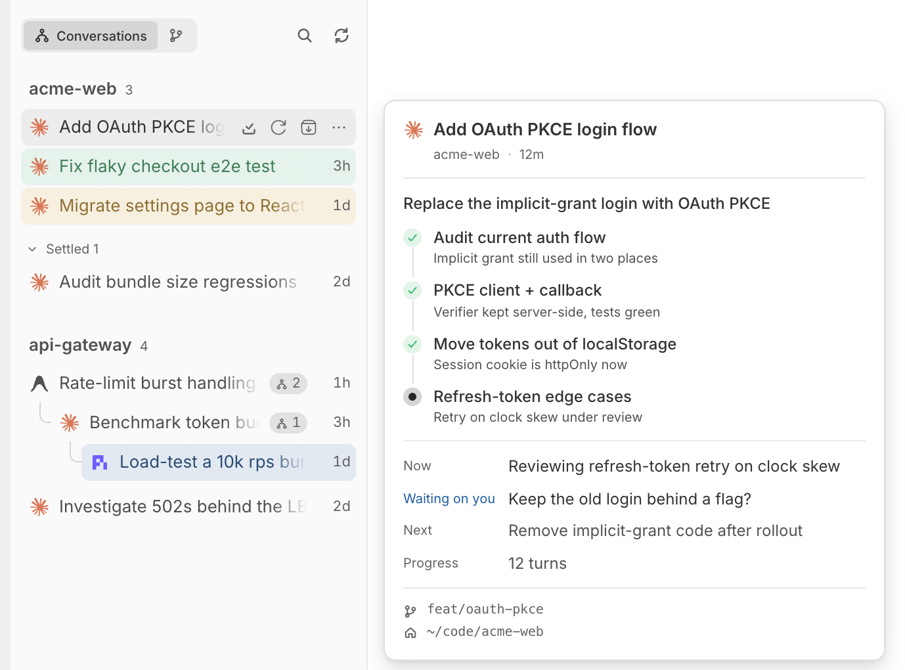
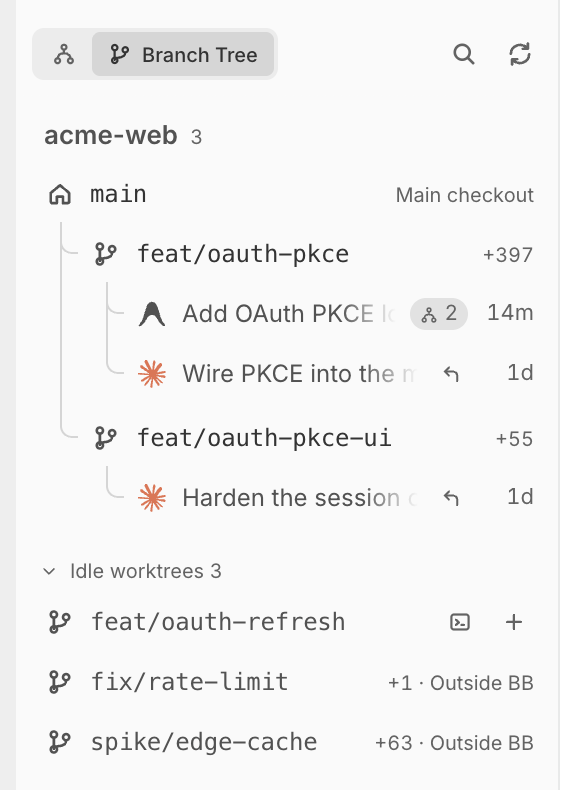

# Worktree Lineage

> **English** | [简体中文](README.zh-CN.md)

**A replacement thread list for the [bb](https://getbb.app) sidebar: see where every conversation stands, and which branch its code came from.**

<table>
  <tr>
    <td width="70%"></td>
    <td width="30%"></td>
  </tr>
  <tr>
    <td align="center"><sub>Conversation view · row colors · Settled shelf · hover briefing</sub></td>
    <td align="center"><sub>Branch Tree view · copy a safe cleanup command</sub></td>
  </tr>
</table>

<sub>Screenshots use demo data. The interface is available in English and Simplified Chinese, never mixed (see <a href="#configuration">Configuration</a>).</sub>

## Views

Two views of the same threads, switched from the top of the list. Each one has a single main subject.

**Conversation (default)**
- One row per thread: provider icon, title, and on the right a dispatched-thread count plus status or time.
- Threads a thread dispatched are indented under it with thin connector lines. Click the count to fold the whole group.
- Sorted by real activity. Just opening a thread to look at it does not move it.
- No branches or worktrees here. To see a thread's branch, hover it or switch views.

**Branch Tree**
- Branches are the main rows, nested by the branch each one was cut from. Small tags on the right show main checkout, commits ahead (`+12`), merged, no worktree, or outside bb.
- Threads hang under their branch as smaller secondary rows.
- Worktrees with no threads and merged branches fold into a footer at the end of each project.
- Projects without git still list their threads.

One alignment rule throughout: a child's icon lines up with its parent's text, and all times, counts and tags share one right edge.

## Highlights

- **Color means something.** Each row has at most one background color:
  - Yellow: unsent text in the composer.
  - Blue: it stopped and is waiting for you (a question or an error; the trailing mark tells them apart).
  - Green: finished and you haven't looked yet.

  Priority is error › waiting for reply › draft › finished-unread. A running thread gets a thin flowing border instead of a color.
- **Hover actions in place:** regenerate title, archive, and more. Right-click opens bb's full thread menu.
- **Quick filter:** press `/` and type. Results come in three groups: title or branch, mentioned in messages, and archived; the last two come from bb's own search.
- **Follows any theme.** Colors come only from bb theme variables. On touch screens, buttons are bigger.
- **Scrolls only vertically.** The list never moves sideways, even on a phone: overflow is clipped and touch gestures only pan up and down.

## Hover Briefings

Rest the pointer on a thread for about half a second and a briefing card appears next to it:
- What the thread is about, in one sentence.
- The stages it went through (done / in progress / dropped, each with a one-line outcome).
- Where it stands now, what it is waiting on you for, and the likely next step.
- Progress: turns, dispatched threads, pull request, lines changed.

Moving between rows morphs one card instead of flashing new ones. You can move onto the card to select and copy text, and `Esc` closes it.

Briefings are written in the background by a small model and saved:
- **When:** only after a turn ends, plus a one-time catch-up at startup for threads active in the last 14 days (at most 40). Hovering only reads the saved result and never calls a model.
- **Free fallback:** until a briefing exists, or once it falls behind, the card shows a zero-cost recap built from bb's conversation outline (your last request and the reply).
- **Guard rails:** one briefing at a time, at most 300 a day, and the queue stops after 3 failures in a row.

**Which model writes them.** The plugin first tries an OpenAI-compatible gateway on your own machine (by default a local Magpie gateway at `http://127.0.0.1:3425`), then falls back to your local Claude Code CLI:

1. `workbuddy/deepseek-v4.1-flash` on the gateway
2. `opencode-zen/deepseek-v4.1-flash-free` on the gateway (free, with a small quota)
3. `claude -p --model haiku` on your machine

**No gateway installed? Nothing to set up.** If nothing listens on that address, the request fails instantly and the plugin uses your local `claude` CLI, retrying the gateway at most once a minute. To skip the gateway entirely, clear `briefingGatewayUrl` (see [Configuration](#configuration)).

> [!NOTE]
> When a gateway is used, the conversation digest (each request plus the start of each reply) is sent to whichever model provider sits behind that gateway. Paid direct APIs are deliberately left out of the default chain.

<details>
<summary>Routing details</summary>

- Each gateway call is one plain HTTP request to `/v1/chat/completions` with a 45 s timeout. No process is started. Measured at 2–6 s per briefing.
- A model that times out, returns an error, or writes output that fails validation is skipped and the next one is tried.
- `429` responses put that model on cooldown for its `Retry-After` value (15 minutes if missing, capped at 25 minutes). An unreachable gateway cools down as a whole for 60 s. Models on cooldown are skipped silently; the cooldown table lives in memory and clears on reload.
- The Claude fallback is a one-shot `claude -p --effort low` that loads no user settings or hooks (`--setting-sources ""`, `disableAllHooks`), saves no session (`--no-session-persistence`), and gets no tools (`--tools ""`, `--strict-mcp-config`), run from an empty temp directory. It uses your Claude subscription; measured at $0.0002–0.002 per briefing.
- The plugin log records which route and model wrote each briefing (`via gateway …` or `via claude … (fallback)`), and each model that failed or was skipped.

</details>

## Shortcuts & Settle

| Action | How |
|---|---|
| Filter threads, branches, projects | `/`, then arrow keys and `Enter`; `Esc` to leave |
| Next / previous thread that needs you | `]` / `[` when focus is not in a text field |
| Same, from anywhere (including the composer) | `Alt/Option + ]` / `[` |
| Jump to the next thread that needs you | Click the count badge at the top of the list |

bb moves focus into the composer when a thread opens, so after the first jump use the `Alt/Option` form. "Needs you" means a yellow, blue or green row. Jumps follow the order you see on screen.

**Settle** parks a finished thread without archiving it:
- Hover a top-level row in the Conversation view and click **Settle**. The thread, with any threads it dispatched, moves into the project's **Settled N** shelf. **Unsettle** moves it back.
- It wakes up by itself as soon as it runs again, gets a draft, waits for you, or shows new activity.
- Settle is stored only in this browser's local storage. It never archives the thread and never touches its worktree or environment. Pinned threads can't be settled.

## Branch Lineage

A branch's origin comes only from records, never from guessing with commit history. In order of trust:

1. The base bb recorded when it created the worktree.
2. git's branch-creation reflog entry `branch: Created from <branch>`.
3. If that entry only has a commit, the branch that pointed at it at the time (for `Created from HEAD`, HEAD's checkout record).
4. Nothing found: shown as unknown.

**Safe cleanup.** In the Branch Tree footer, an idle or merged worktree that bb doesn't manage gets a button that copies a cleanup command:

```sh
git -C <main checkout> worktree remove <path>            # idle worktree
git -C <main checkout> worktree remove <path> && git -C <main checkout> branch -d <branch>   # merged
```

<details>
<summary>What the cleanup button will and won't do</summary>

- It only copies text. The plugin itself only reads git and never deletes a directory or branch.
- The command never contains `--force` or `-D`, so git refuses if the worktree has uncommitted changes or the branch has unmerged commits.
- It is not offered for the main checkout, for worktrees bb created (bb removes those itself when you archive the thread; deleting them behind bb's back would leave stale environments), or while any thread in that worktree is running, waiting, or in error.

</details>

## Configuration

| Setting | Default | What it does |
|---|---|---|
| `language` | `auto` | Interface and briefing language: `auto`, `en` or `zh`. `auto` follows BB's own interface language, so an English BB gets an English list. Pick `zh` to use Chinese in an English BB. |
| `briefingEnabled` | `true` | Write hover briefings with a small model. Off: cards show only the zero-cost recap. |
| `briefingGatewayUrl` | `http://127.0.0.1:3425` | OpenAI-compatible gateway tried first. Leave empty to use only the local Claude CLI. |
| `briefingGatewayModel` | `workbuddy/deepseek-v4.1-flash, opencode-zen/deepseek-v4.1-flash-free` | Comma-separated models on that gateway, tried in order. A single name works too. |
| `briefingModel` | `haiku` | Model passed to `claude --model` when every gateway model fails. |

Change them in bb's plugin settings, or from the CLI. Changing `language` takes effect immediately:
- Whichever language you pick, the whole interface uses only that language. That covers buttons, tags, times (`5m` / `5分钟`), tooltips and the hover card. In Chinese, Settle becomes 搁置 and Settled becomes 已搁置.
- Briefings are rewritten in the new language. Until then, a card shows only the recap, never text in the other language.
- The settings page itself is rendered by bb and stays in English.

```sh
bb plugin config worktree-lineage                                   # show current values
bb plugin config worktree-lineage set language zh                   # en | zh | auto
bb plugin config worktree-lineage set briefingEnabled false
bb plugin config worktree-lineage set briefingGatewayModel "my-provider/my-model"
bb plugin config worktree-lineage set briefingModel sonnet
bb plugin config worktree-lineage unset briefingGatewayModel        # back to the default
```

### Settings panel

The plugin's page in bb (**Settings → Plugins → Worktree Lineage**) adds a **Status and quick actions** panel below bb's generated configuration form:
- **Language**: one-tap switch between Auto, English and 简体中文. It applies immediately to the list and the panel.
- **Hover briefings**: an on/off switch, plus live status. Status covers the route, the briefing language, the last briefing and today's count against the daily limit. It also lists any models cooling down, threads waiting to retry, and a pause after repeated failures, with a button to clear them.
- **Settled threads**: how many threads are settled in this browser, and **Unsettle all**. This clears only this browser's records and never archives anything.

The panel writes the same settings as the form above and as `bb plugin config`.

## Install

Requires bb 0.49 or later. Hover briefings use the `claude` CLI if it is installed.

```sh
git clone https://github.com/waiclay-349687/bb-plugin-worktree-lineage.git
cd bb-plugin-worktree-lineage
npm install --include=dev
bb plugin build .
bb plugin install "path:$PWD" --yes
bb settings ui set sidebar.threadListProvider worktree-lineage/lineage
```

To go back to bb's built-in thread list:

```sh
bb settings ui reset sidebar.threadListProvider
```

## Develop

```sh
npx tsc --noEmit -p tsconfig.json    # typecheck
npx vitest run                       # tests
bb plugin build .                    # build
bb plugin reload worktree-lineage    # reload after a change
```

The plugin only reads git and never modifies a repository. Apart from writing briefings through your gateway or local `claude`, it makes no network calls. The plugin is built on bb's `experimental_*` SDK APIs, so check it again after bb upgrades.

## Related BB Plugins

- [bb-plugin-worktree-lineage](https://github.com/waiclay-349687/bb-plugin-worktree-lineage) (this plugin) — Sidebar thread list with Conversation and Branch Tree views, Settle, attention jumps, hover briefings and smooth motion.
- [bb-plugin-session-cockpit](https://github.com/waiclay-349687/bb-plugin-session-cockpit) — Top-right thread cockpit with Progress, Usage & live Context breakdown, real-time Context files tracking, Servers, Scripts, and Connectors.
- [bb-plugin-usage-rings](https://github.com/waiclay-349687/bb-plugin-usage-rings) — Bottom-left sidebar usage rings with pace tracking across providers including Antigravity.

## License

MIT, see [LICENSE](LICENSE).
