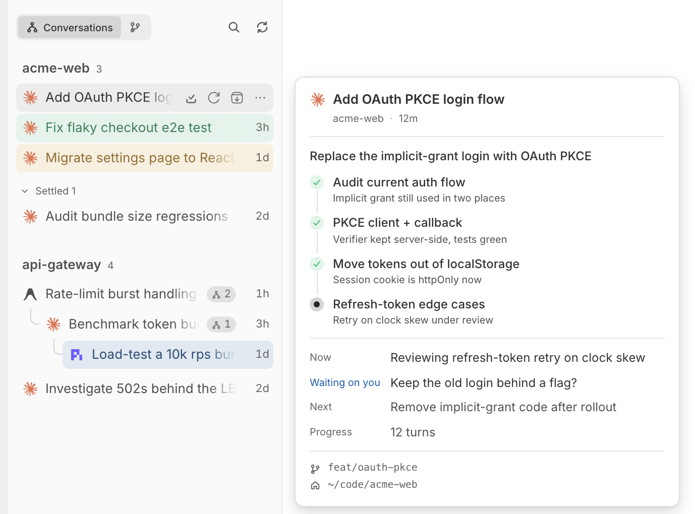
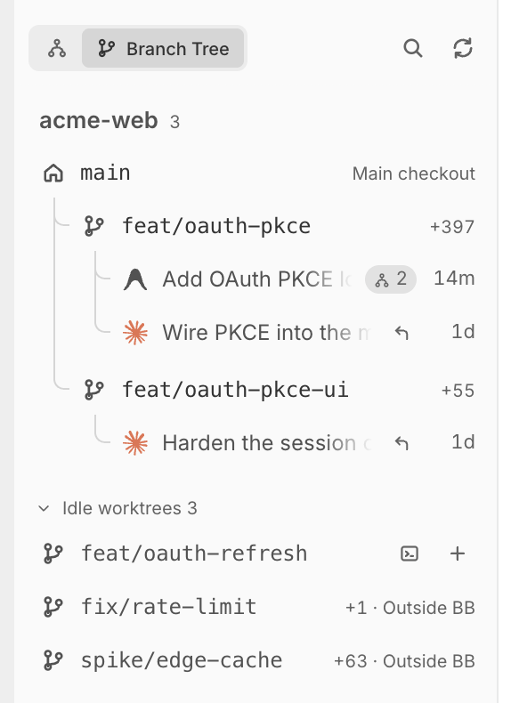

# Worktree 血缘

> [English](README.md) | **简体中文**

**替换 [bb](https://getbb.app) 侧边栏的线程列表：每条对话进行到哪了、代码从哪个分支切出来，一眼看清。**

<table>
  <tr>
    <td width="70%"></td>
    <td width="30%"></td>
  </tr>
  <tr>
    <td align="center"><sub>对话视图 · 行色 · 搁置架子 · 悬停速览</sub></td>
    <td align="center"><sub>分支树视图 · 复制安全清理命令</sub></td>
  </tr>
</table>

<sub>截图使用的是演示数据，界面为英文；插件界面支持英文与简体中文，两种语言互不混用（见<a href="#配置">配置</a>）。</sub>

## 两种视图

同一批对话的两种排列，在列表顶部切换，各有一个主角。

**对话（默认）**
- 一条对话一行：provider 图标、标题，右侧是派出数量和状态或时间。
- 它派出的对话缩进一格排在下面，用细拐线连着；点派出数量可以整组收起。
- 按最近的真实活动排序，只是点开看一眼不算。
- 这里不出现分支和工作树。想知道一条对话在哪个分支，悬停看速览卡，或者切到分支树。

**分支树**
- 分支是主行，按“从哪个分支切出来”嵌套；右侧小字标明主检出、领先几个提交（`+12`）、已合回、无工作树、外部工作树。
- 对话挂在分支下面，是小一号的次级行。
- 没有对话的工作树和已合回的分支，收进每个项目末尾的页脚（“已合回 N · 空闲工作树 N”）。
- 没有 git 的项目照常列出对话。

全列表只有一条对齐规则：下一级的图标对齐上一级文字的左缘；时间、数量、分支标记都贴同一条右边线。

## 亮点

- **颜色即含义**，一行最多一种底色：
  - 黄：输入框里有没发出去的草稿。
  - 蓝：它停下来等你，问了问题或出错了（行尾的标记区分这两种）。
  - 绿：做完了，你还没看。

  同时满足几种时按“出错 › 等你回复 › 草稿 › 完成未读”取一种。运行中的对话不占底色，外缘是一圈细细的流光描边。
- **悬停即操作**：行尾原地换成重新生成标题、归档、更多；右键是 bb 完整的线程菜单。
- **快速筛选**：按 `/` 输入，结果分三组：标题或分支、消息里提到、已归档；后两组来自 bb 官方搜索。
- **跟随任意主题**：颜色只用 bb 的主题变量；触屏下操作按钮常显，点击区域更大。

## 悬停速览

鼠标在一条对话上停半秒左右，旁边浮出一张速览卡：
- 一句话说明这条对话在做什么。
- 按时间归并出的几个阶段（已完成 / 进行中 / 已放弃，各带一句结论）。
- 现在停在哪、等你做什么决定、下一步大概做什么。
- 进展：轮数、派出的对话、PR、改动行数。

在对话之间移动时，是同一张卡片连续变形，不会一闪一闪。鼠标可以移到卡片上选中、复制文字，`Esc` 收起。

速览由小模型在后台写好并存盘：
- **什么时候写**：只在一轮对话结束后写；启动时另为最近 14 天活跃的对话补写一次（最多 40 条）。悬停只读存盘的结果，从不调用模型。
- **免费兜底**：速览还没写出来、或者已经落后于对话时，卡片先显示不花额度的摘要（取自 bb 的对话大纲：你最近的要求和答复）。
- **保护**：一次只写一条，每天最多 300 次，连续失败 3 次就停止排队。

**由哪个模型来写**：先试你本机上的 OpenAI 兼容网关（默认是本机 Magpie 网关 `http://127.0.0.1:3425`），不行再回退到本机的 Claude Code CLI：

1. 网关上的 `workbuddy/deepseek-v4.1-flash`
2. 网关上的 `opencode-zen/deepseek-v4.1-flash-free`（免费，额度较少）
3. 本机的 `claude -p --model haiku`

**没装网关？什么都不用配。** 那个地址上没有服务时，请求会立刻失败，插件直接改用本机的 `claude` CLI，并且最多每分钟才重新试一次网关。想完全不走网关，把 `briefingGatewayUrl` 清空即可（见[配置](#配置)）。

> [!NOTE]
> 走网关时，对话提要（每一轮的要求和答复开头）会发给网关背后的模型服务商。默认链里刻意不放按量付费的直连 API。

<details>
<summary>路由细节</summary>

- 每次网关调用都是一次纯 HTTP 请求（`/v1/chat/completions`，45 秒超时），不启动任何进程；实测每条 2–6 秒。
- 某个模型超时、报错，或者写出来的内容过不了校验，就跳过它试下一个。
- 返回 `429` 的模型按 `Retry-After` 冷却（没给就 15 分钟，最多 25 分钟）；网关整体连不上时冷却 60 秒。冷却中的模型直接跳过、不刷日志；冷却表只在内存里，插件重载即清空。
- 回退到 Claude 时是一次性的 `claude -p --effort low`：不加载用户的设置和钩子（`--setting-sources ""`、`disableAllHooks`），不保存会话（`--no-session-persistence`），不带任何工具（`--tools ""`、`--strict-mcp-config`），在空的临时目录里运行。走你的 Claude 订阅额度，实测每条 $0.0002–0.002。
- 插件日志会写明每条速览走的通道和模型（`via gateway …` 或 `via claude … (fallback)`），以及哪些模型失败或被跳过。

</details>

## 快捷键与搁置

| 操作 | 方式 |
|---|---|
| 筛选对话、分支、项目 | `/`，方向键选择，`Enter` 打开，`Esc` 退出 |
| 跳到下一条 / 上一条需要你的对话 | 焦点不在输入框里时按 `]` / `[` |
| 同上，任何地方都能用（包括输入框里） | `Alt/Option + ]` / `[` |
| 跳到下一条需要你的对话 | 点列表顶部的数量徽标 |

bb 打开对话后会把焦点放进输入框，所以跳过一次之后，请用 `Alt/Option` 组合键继续。“需要你”指黄、蓝、绿三种底色的对话，跳转顺序和你在屏幕上看到的一致。

**搁置**（英文界面叫 Settle）：把做完的对话先收起来，但不归档：
- 在对话视图里悬停一条顶层对话，点 **搁置**，它连同派出的对话一起收进项目底部的 **已搁置 N** 架子；点 **取消搁置** 移回主列表。
- 只要它重新运行、出现草稿、等你回复或有新活动，会自动回到主列表。
- 搁置只记在当前浏览器的本地存储里，不会归档对话，也不碰它的工作树和环境。置顶的对话不能搁置。

## 分支起点

分支的起点只认记录，不按提交历史推算。可信度从高到低：

1. bb 建工作树时记录的起点。
2. git 的分支创建记录 `branch: Created from <分支>`。
3. 创建记录里只有提交号时，反查当时哪个分支指向它（`Created from HEAD` 时查 HEAD 的 checkout 记录）。
4. 都查不到：标为“来源未知”。

**安全清理**：分支树页脚里，bb 没有托管的空闲或已合回工作树会多一个按钮，用来复制清理命令：

```sh
git -C <主检出> worktree remove <路径>            # 空闲工作树
git -C <主检出> worktree remove <路径> && git -C <主检出> branch -d <分支>   # 已合回
```

<details>
<summary>清理按钮会做什么、不会做什么</summary>

- 它只复制文字。插件本身只读 git，从不删目录、也不删分支。
- 命令里绝不带 `--force` 或 `-D`：工作树里有未提交的改动、或分支有未合回的提交时，git 会拒绝执行。
- 以下情况不提供这个按钮：主检出；bb 建的工作树（归档对话时 bb 会自己删，绕过 bb 删会留下悬空的环境记录）；工作树里还有对话在运行、等你或出错。

</details>

## 配置

| 设置项 | 默认值 | 作用 |
|---|---|---|
| `language` | `auto` | 界面与速览的语言：`auto`、`en` 或 `zh`。`auto` 跟随 BB 自己的界面语言，英文 BB 里就是英文；想在英文 BB 里用中文，选 `zh`。 |
| `briefingEnabled` | `true` | 是否用小模型写悬停速览。关闭后卡片只显示不花额度的摘要。 |
| `briefingGatewayUrl` | `http://127.0.0.1:3425` | 优先尝试的 OpenAI 兼容网关。留空则只用本机的 Claude CLI。 |
| `briefingGatewayModel` | `workbuddy/deepseek-v4.1-flash, opencode-zen/deepseek-v4.1-flash-free` | 网关上按顺序尝试的模型，逗号分隔；只写一个也行。 |
| `briefingModel` | `haiku` | 网关上的模型都失败时，传给 `claude --model` 的模型名。 |

在 bb 的插件设置里修改，或者用命令行。改 `language` 立即生效：
- 选了哪种语言，整个界面就只用这种语言。按钮、标记、时间（`5m` / `5分钟`）、提示和悬停卡片都算在内。
- 速览会按新语言重写；重写之前卡片只显示摘要，不会混进另一种语言。
- 设置页本身由 bb 渲染，固定为英文，各项设置的中文说明见上表。

```sh
bb plugin config worktree-lineage                                   # 查看当前值
bb plugin config worktree-lineage set language zh                   # en | zh | auto
bb plugin config worktree-lineage set briefingEnabled false
bb plugin config worktree-lineage set briefingGatewayModel "my-provider/my-model"
bb plugin config worktree-lineage set briefingModel sonnet
bb plugin config worktree-lineage unset briefingGatewayModel        # 恢复默认
```

## 安装

需要 bb 0.49 或更高版本；装了 `claude` CLI 时，悬停速览会用它兜底。

```sh
git clone https://github.com/waiclay-349687/bb-plugin-worktree-lineage.git
cd bb-plugin-worktree-lineage
npm install --include=dev
bb plugin build .
bb plugin install "path:$PWD" --yes
bb settings ui set sidebar.threadListProvider worktree-lineage/lineage
```

回退到 bb 自带的线程列表：

```sh
bb settings ui reset sidebar.threadListProvider
```

## 开发

```sh
npx tsc --noEmit -p tsconfig.json    # 类型检查
npx vitest run                       # 测试
bb plugin build .                    # 构建
bb plugin reload worktree-lineage    # 改动后重载
```

插件只读 git，从不修改仓库；除了通过你的网关或本机 `claude` 写速览，不发起任何网络请求。插件基于 bb 的 `experimental_*` SDK 接口，bb 升级后需要回归检查。

## 同系列 BB 插件

- [bb-plugin-worktree-lineage](https://github.com/waiclay-349687/bb-plugin-worktree-lineage)（本插件）：侧边栏线程列表，对话 / 分支树双视图，带 Settle、待办快跳、悬停速览与丝滑动效。
- [bb-plugin-session-cockpit](https://github.com/waiclay-349687/bb-plugin-session-cockpit)：右上角会话驾驶舱，展示阶段进度、实时上下文占比与文件读取统计、缓存、本地服务与项目脚本。
- [bb-plugin-usage-rings](https://github.com/waiclay-349687/bb-plugin-usage-rings)：左下角侧边栏额度圆环，统一展示各家 Agent 计划用量与配速（含 Antigravity）。

## License

MIT, see [LICENSE](LICENSE).
